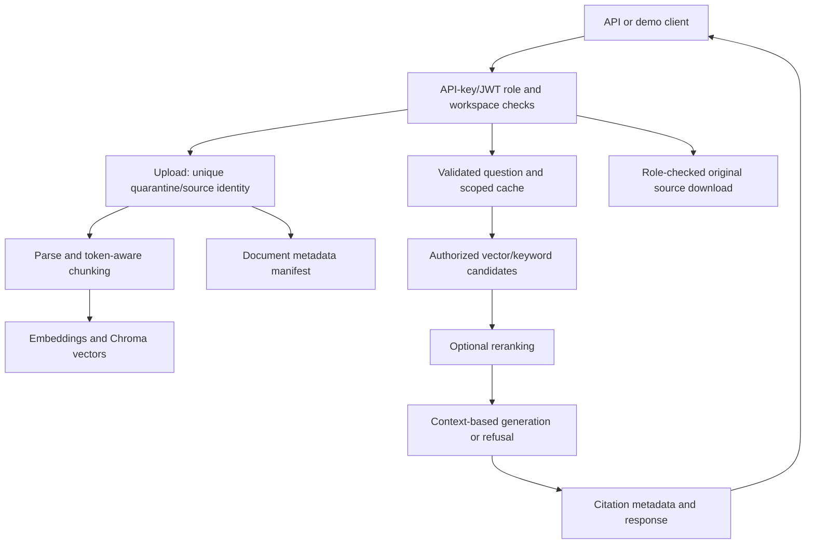

# PRODUCTION-RAG — local document retrieval application

Repository: https://github.com/ramshetty01/PRODUCTION-RAG

## Purpose and verified status

Ingest documents, retrieve role/workspace-filtered evidence and return cited answers
through a FastAPI service and browser demo. The name expresses an engineering target;
it does not establish production certification. This maintenance run validates local
code and selected integration paths, not a public multi-tenant deployment.

## Actual technology stack

Python 3.11+; FastAPI/Uvicorn/Pydantic; LangChain document loaders, splitters and vector
adapters; Chroma local persistence; deterministic hash embeddings by default with
optional Hugging Face embeddings; keyword/vector hybrid retrieval and lexical or optional
cross-encoder reranking; extractive/local synthesis or optional OpenAI-compatible model
clients; plain HTML/CSS/JavaScript demo; JSON document manifest; pytest and GitHub Actions.
Optional integrations include Qdrant, Postgres metadata, object storage, Redis and JWT
identity. Their presence is not evidence of a tested hosted deployment. Python dependencies
remain broadly unpinned; the existing security workflow is separate from the code tests.

## Architecture and workflow



A workspace upload gets a unique physical path and document identity; the original
filename is preserved for display. Parsed chunks carry document/version/source/role
metadata. Querying combines retrieval, role filters, optional reranking, prompt assembly
and generation. Returned citations identify retrieved chunks. Source-download access is
checked independently, because protecting retrieval alone does not protect source bytes.
Server-path ingestion is restricted to a global admin; workspace admins use scoped uploads.

API-key subjects now derive from a full SHA-256 fingerprint rather than the first six
characters, preventing shared-prefix keys from sharing conversation/cache/quota identity.
This is an identifier, not password encryption; keys must remain high entropy and secret.
Legacy prefix-based identities are not reused after upgrade.

## Changes and evidence

- #305 / PR #306: fixed a retention regression whose expected result depended on today's date.
- #301 / PR #307: protected server-side ingestion and enforced source-download access roles.
- #302 / PR #308: isolated physical upload/document identities across users/workspaces and
  retained display filenames during reindex.
- #303 / PR #309: removed API-key prefix identity collisions; 272 tests pass at this milestone.
- #304: replaced the misleading reference-answer evaluation path with explicit prediction
  diagnostics and unavailable semantic metrics when no actual judgments exist.
- Earlier local integration smoke used real Chroma with hash embeddings and extractive
  generation: upload → query → cited answer → source download passed. This is not neural
  model accuracy evidence. No paid provider calls were used in this maintenance run.

PRs are stacked and unmerged; confirm GitHub state before claiming a fix is on main.
After the evaluation correction, 276 tests pass. The fixture-validation CLI and the required-quality-gate failure path are tested without provider calls. The optional Ragas judge was not live-tested.

## Evaluation limitations

The old faithfulness=1.0 metric scored reference answers against reference evidence,
not model predictions. It has been withdrawn as a quality claim. Fixture `verified`
flags are inherited metadata, not proof of independent review. The default evaluator
now validates fixtures only. Actual JSONL predictions are required for lexical proxies;
semantic faithfulness needs explicit external-judge/human evaluation. Missing predictions
are not silently dropped. The UI shows Not evaluated without semantic evidence.

## Setup and verification

```sh
python3.12 -m venv .venv
. .venv/bin/activate
pip install -r requirements.txt
python -m pytest -q
python evals/run_ragas.py --config configs/settings.toml
python scripts/ingest.py --pdf docs.pdf --build-vector-db
python -m uvicorn main:app --host 127.0.0.1 --port 8000
```

Configure authentication and private storage before sharing. Default hash embeddings
and extractive generation allow local validation without hosted credentials. See
README, docs/SECRETS.md, docs/EVALUATION.md and docs/DEPLOYMENT.md for boundaries.

## Remaining production blockers

Issue #310: the JSON manifest is nontransactional across concurrent mutations; even a single process
can have overlapping request threads. Use only local evaluation with serialized document
mutations until a transactional boundary is implemented. Issue #311: reindex currently does not
atomically retire stale vector versions or recover coherently from partial failure.
These gaps require concurrency/failure tests and actual-backend validation, not a claim
that unique filenames alone provide complete tenant lifecycle isolation.

Other gaps: pinned/audited dependencies; validated identity/authorization configuration;
transactional document/vector/object lifecycle; distributed quotas and cache controls;
TLS/network policy; independent quality evaluation; deployed latency/load/recovery tests;
and live-provider integration evidence. No production traffic or uptime is claimed.

## Truthful resume bullets and interview topics

- Hardened a FastAPI/Chroma document retrieval app by enforcing ingestion/source-download
  authorization and isolating uploaded source identities across workspaces.
- Added regression tests for equal-prefix API-key collisions and conversation isolation,
  replacing partial-key subjects with stable opaque fingerprints.
- Corrected an evaluation leakage bug by separating reference validation from actual
  prediction diagnostics and making unmeasured semantic metrics explicit.

Prepare to explain tenant/role checks at both retrieval and download boundaries, why
hash embeddings are useful for offline integration tests but not neural retrieval claims,
how stale vectors and nontransactional manifests break lifecycle consistency, and why
an expected-answer self-check cannot establish model faithfulness.
